# TP17 : Sécurité Kubernetes

RBAC, Pod Security Standards, NetworkPolicy, Kyverno, Trivy Operator, Kubescape, Falco et OPA Gatekeeper, appliqués à une petite application volontairement mal configurée.

> **Auteur :** Wissal El Kouk  
> **Environnement :** VM Ubuntu Server (VMware, réseau NAT), K3s mono-nœud, 8 Go de RAM

---

## Sommaire

1. [Objectifs](#1-objectifs)
2. [Environnement et outils](#2-environnement-et-outils)
3. [Structure du dépôt](#3-structure-du-dépôt)
4. [Application de départ](#4-application-de-départ)
5. [Partie 1 : RBAC et ServiceAccount](#5-partie-1--rbac-et-serviceaccount)
6. [Partie 2 : securityContext](#6-partie-2--securitycontext)
7. [Partie 3 : Pod Security Standards](#7-partie-3--pod-security-standards)
8. [Partie 4 : NetworkPolicies](#8-partie-4--networkpolicies)
9. [Partie 5 : Policy as Code avec Kyverno](#9-partie-5--policy-as-code-avec-kyverno)
10. [Partie 6 : Analyse continue et détection](#10-partie-6--analyse-continue-et-détection-à-lexécution)
11. [Défis](#11-défis)
12. [Difficultés rencontrées](#12-difficultés-rencontrées)
13. [Récapitulatif des livrables](#13-récapitulatif-des-livrables)
14. [Conclusion](#14-conclusion)

---

## 1. Objectifs

- Appliquer le moindre privilège avec ServiceAccount, Role et RoleBinding, et le vérifier avec `kubectl auth can-i`.
- Durcir des Pods (`runAsNonRoot`, `readOnlyRootFilesystem`, `capabilities.drop`, `seccompProfile`) et appliquer les Pod Security Standards.
- Écrire des NetworkPolicies *default deny*, puis n'ouvrir que les flux nécessaires.
- Écrire et tester des policies Kyverno (Audit puis Enforce).
- Analyser le cluster avec Trivy Operator et Kubescape, et détecter un comportement suspect avec Falco.

## 2. Environnement et outils

| Composant | Version / détail |
|---|---|
| Hyperviseur | VMware Workstation, réseau NAT (`10.0.0.0/24`) |
| OS | Ubuntu Server, noyau 7.0.0 |
| Kubernetes | K3s v1.37.2 (mono-nœud) |
| Helm | v4.3.2 |
| Kyverno | v1.20.0 |
| Trivy Operator | chart `aqua/trivy-operator` (scan limité au namespace `tp17`) |
| Kubescape | v4.0.21 (framework NSA) |
| Falco | driver `modern_ebpf`, socket containerd K3s |
| Gatekeeper | chart `gatekeeper/gatekeeper` |

Accès à la VM par SSH : `ssh wissal@10.0.0.25`.

## 3. Structure du dépôt

```
.
├── README.md
├── captures/
│   ├── app-depart.png
│   ├── rbac-can-i.png
│   ├── pods-durcis.png
│   ├── pss-denied.png
│   ├── netpol.png
│   ├── kyverno-cli.png
│   ├── kyverno-enforce.png
│   ├── trivy-configaudit.png
│   ├── kubescape-cluster.png
│   ├── trivy-kubescape.png
│   ├── falco-alert.png
│   ├── mutation-seccomp.png
│   └── gatekeeper-deny.png
├── manifests/
│   ├── 00-app.yaml            # application de départ (non conforme)
│   ├── 10-rbac.yaml           # ServiceAccount, Role, RoleBinding
│   ├── 20-networkpolicies.yaml
│   └── 30-hardened.yaml       # Deployments durcis
└── policies/
    ├── disallow-latest-tag.yaml
    ├── disallow-privileged.yaml
    ├── require-run-as-nonroot.yaml
    ├── require-requests-limits.yaml
    ├── mutate-seccomp.yaml        # défi 1 : mutation
    └── gatekeeper-no-latest.yaml  # défi 2 : Rego
```

## 4. Application de départ

Le namespace `tp17` contient trois workloads volontairement fragiles :

| Workload | Image | Problèmes |
|---|---|---|
| `api` | `traefik/whoami:latest` | tag `latest`, `privileged: true`, pas de limites, root |
| `frontend` | `nginx:latest` | tag `latest`, root, pas de limites |
| `intruder` | `busybox:1.36` | pod « attaquant » utilisé pour les tests réseau et Falco |

```bash
kubectl apply -f manifests/00-app.yaml
kubectl -n tp17 get pods --show-labels
```

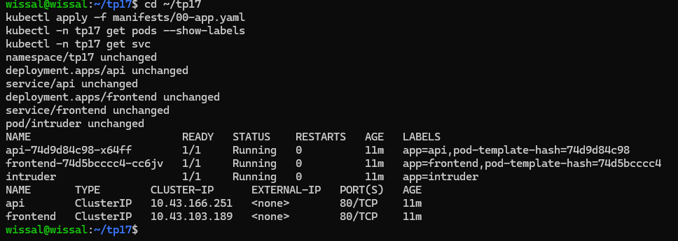

Les trois Pods passent à `Running` : un cluster par défaut accepte tout sans objection.

---

## 5. Partie 1 : RBAC et ServiceAccount

### Permissions du ServiceAccount `default`

```bash
kubectl auth can-i --list --as=system:serviceaccount:tp17:default -n tp17
```

### Moindre privilège : `manifests/10-rbac.yaml`

Un ServiceAccount `api-sa` avec un `Role` en **lecture seule sur les ConfigMaps** du namespace, relié par un `RoleBinding`.

```yaml
apiVersion: v1
kind: ServiceAccount
metadata:
  name: api-sa
  namespace: tp17
automountServiceAccountToken: false
---
apiVersion: rbac.authorization.k8s.io/v1
kind: Role
metadata:
  name: configmap-reader
  namespace: tp17
rules:
- apiGroups: [""]
  resources: ["configmaps"]
  verbs: ["get", "list", "watch"]
---
apiVersion: rbac.authorization.k8s.io/v1
kind: RoleBinding
metadata:
  name: api-sa-configmap-reader
  namespace: tp17
subjects:
- kind: ServiceAccount
  name: api-sa
  namespace: tp17
roleRef:
  kind: Role
  name: configmap-reader
  apiGroup: rbac.authorization.k8s.io
```

### Vérification

```bash
SA=system:serviceaccount:tp17:api-sa
kubectl auth can-i get configmaps --as=$SA -n tp17      # yes
kubectl auth can-i list secrets   --as=$SA -n tp17      # no
kubectl auth can-i get configmaps --as=$SA -n default   # no (Role = un seul namespace)
kubectl auth can-i create pods    --as=$SA -n tp17      # no
```

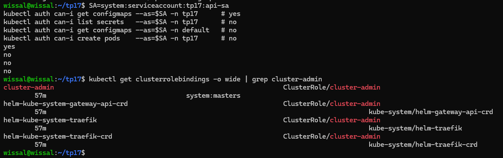

Résultat : `yes`, `no`, `no`, `no`, comme attendu.

### Pourquoi `automountServiceAccountToken: false` ?

Par défaut, Kubernetes monte un jeton d'API dans chaque Pod. Si le conteneur est compromis, l'attaquant peut voler ce jeton et appeler l'API server avec les droits du ServiceAccount. Quand l'application n'a pas besoin de parler à l'API, supprimer le jeton réduit la surface d'attaque.

### Role / ClusterRole et RoleBinding / ClusterRoleBinding

| Objet | Portée |
|---|---|
| **Role** | Droits dans **un seul namespace** |
| **ClusterRole** | Droits à l'échelle du **cluster** (nodes, PV, namespaces) ou modèle réutilisable dans tous les namespaces |
| **RoleBinding** | Donne un Role (ou ClusterRole) à un sujet **dans un namespace** |
| **ClusterRoleBinding** | Donne un ClusterRole à un sujet **sur tout le cluster** |

### ClusterRoleBindings `cluster-admin`

```bash
kubectl get clusterrolebindings -o wide | grep cluster-admin
```

| Binding | Sujet |
|---|---|
| `cluster-admin` | groupe `system:masters` |
| `helm-kube-system-gateway-api-crd` | SA `kube-system/helm-gateway-api-crd` |
| `helm-kube-system-traefik` | SA `kube-system/helm-traefik` |
| `helm-kube-system-traefik-crd` | SA `kube-system/helm-traefik-crd` |

Ces comptes ont des droits totaux sur le cluster : ce sont des cibles prioritaires à surveiller.

---

## 6. Partie 2 : securityContext

Fichier : `manifests/30-hardened.yaml`.

| Option | `api` | `frontend` |
|---|---|---|
| Image taggée | `traefik/whoami:v1.10.3` | `nginxinc/nginx-unprivileged:1.29` |
| `privileged` | `false` | `false` |
| `runAsNonRoot` / `runAsUser` | `true` / `65532` | `true` / `65532` |
| `allowPrivilegeEscalation` | `false` | `false` |
| `readOnlyRootFilesystem` | `true` | `true` |
| `capabilities.drop` | `ALL` | `ALL` |
| `seccompProfile` | `RuntimeDefault` | `RuntimeDefault` |
| `requests` / `limits` | oui | oui |
| ServiceAccount | `api-sa`, token non monté | token non monté |
| Volume `emptyDir` sur `/tmp` | non | oui (nginx écrit dans `/tmp`) |

Le port du frontend passe à `8080` (image *unprivileged*), et le Service `frontend` est mis à jour en `targetPort: 8080`.

```bash
kubectl apply -f manifests/30-hardened.yaml
kubectl -n tp17 rollout status deploy/api
kubectl -n tp17 rollout status deploy/frontend
kubectl -n tp17 exec deploy/frontend -- id
kubectl -n tp17 exec deploy/frontend -- touch /etc/test    # Read-only file system
```

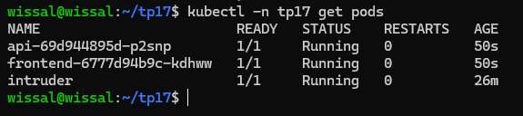

---

## 7. Partie 3 : Pod Security Standards

| Profil | Interdit notamment |
|---|---|
| `privileged` | Rien |
| `baseline` | `privileged`, `hostNetwork`, `hostPath`, capacités dangereuses |
| `restricted` | En plus : root, élévation de privilèges, capacités non retirées, seccomp absent |

Passage en mode avertissement, puis en `enforce` une fois les Deployments conformes :

```bash
kubectl label ns tp17 pod-security.kubernetes.io/warn=restricted \
  pod-security.kubernetes.io/audit=restricted --overwrite
kubectl -n tp17 rollout restart deploy
kubectl label ns tp17 pod-security.kubernetes.io/enforce=restricted --overwrite
```

Aucun avertissement pour `api` et `frontend` : ils sont conformes au profil `restricted`.

### Test d'un Pod privilégié

```bash
kubectl apply -f /tmp/priv.yaml   # Pod busybox avec privileged: true
```

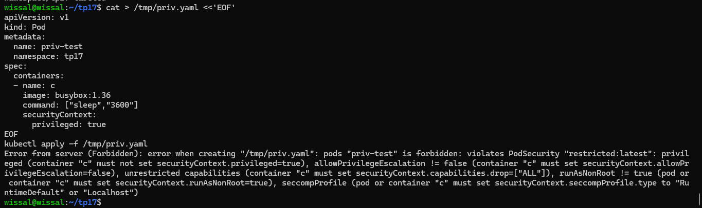

L'API server refuse le Pod avec `violates PodSecurity "restricted:latest"` et liste cinq violations : `privileged`, `allowPrivilegeEscalation`, `capabilities`, `runAsNonRoot`, `seccompProfile`.

> Le Pod `intruder` n'est pas conforme au profil `restricted`. Il continue de tourner (les Pods existants ne sont pas expulsés), mais ne pourrait pas être recréé dans ce namespace.

---

## 8. Partie 4 : NetworkPolicies

Fichier : `manifests/20-networkpolicies.yaml`.

| Policy | Rôle |
|---|---|
| `default-deny-all` | Bloque tout le trafic entrant et sortant du namespace (DNS compris) |
| `allow-dns` | Autorise la sortie DNS (UDP/TCP 53) vers `kube-dns` |
| `frontend-egress-to-api` | `frontend` peut sortir uniquement vers `api` sur le port 8080 |
| `api-ingress-from-frontend` | `api` accepte uniquement le trafic venant de `frontend` sur le port 8080 |

Le port utilisé dans la policy est celui du **Pod** (8080), pas celui du Service (80).

### Vérification

```bash
kubectl -n tp17 exec deploy/frontend -- curl -s -m 3 http://api   # OK
kubectl -n tp17 exec intruder        -- wget -qO- -T 3 http://api   # bloqué
```

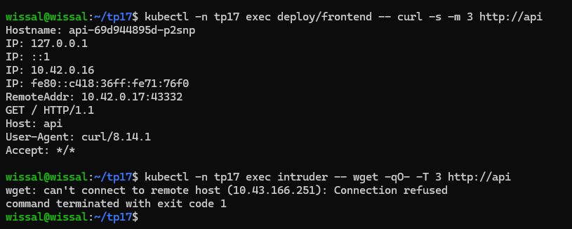

- Le frontend joint l'API (réponse `whoami`).
- L'intrus est bloqué : `Connection refused`. Selon l'implémentation CNI (kube-router sur K3s), un flux interdit est rejeté ou ignoré, ce qui donne un rejet immédiat ou un timeout. L'effet est le même.
- L'image `nginx-unprivileged` ne contient pas `wget`, d'où l'usage de `curl`.

---

## 9. Partie 5 : Policy as Code avec Kyverno

### Installation

```bash
helm repo add kyverno https://kyverno.github.io/kyverno/ && helm repo update
helm install kyverno kyverno/kyverno -n kyverno --create-namespace --timeout 15m
```

### Migration vers les `ValidatingPolicy`

Kyverno **v1.20 n'accepte plus** la création de `ClusterPolicy` (`kyverno.io/v1`) : l'API reste disponible en lecture et suppression seulement. Les quatre règles sont donc écrites en **`ValidatingPolicy`** (`policies.kyverno.io/v1`), basées sur des expressions **CEL**.

| Policy | Règle |
|---|---|
| `disallow-latest-tag` | Image avec tag explicite, `:latest` interdit |
| `disallow-privileged` | Pas de conteneur privilégié |
| `require-run-as-nonroot` | `runAsNonRoot: true` au niveau du Pod ou de chaque conteneur |
| `require-requests-limits` | `requests` cpu et memory, `limits` memory obligatoires |

Exemple (`policies/disallow-latest-tag.yaml`) :

```yaml
apiVersion: policies.kyverno.io/v1
kind: ValidatingPolicy
metadata:
  name: disallow-latest-tag
spec:
  validationActions: [Audit]
  evaluation:
    background:
      enabled: true
  matchConstraints:
    resourceRules:
    - apiGroups: [""]
      apiVersions: ["v1"]
      operations: ["CREATE", "UPDATE"]
      resources: ["pods"]
  validations:
  - expression: "object.spec.containers.all(c, c.image.contains(':') && !c.image.endsWith(':latest'))"
    message: "Chaque image doit avoir un tag explicite, et ':latest' est interdit."
```

### Mode Audit et rapports

```bash
kubectl apply -f policies/
kubectl get validatingpolicies        # READY = true pour les 4
kubectl get policyreports -A
```

Résultats des rapports dans `tp17` :

| Ressource | Pass | Fail |
|---|---|---|
| Pod `intruder` | 2 | 2 (requests/limits, runAsNonRoot) |
| Pods `api` et `frontend` durcis | 4 | 0 |
| Ancien ReplicaSet `api` (`latest`, privileged) | 0 | 4 |

Les composants de `kube-system` (coredns, traefik, local-path-provisioner) échouent aussi sur plusieurs règles : ils ne sont pas durcis par K3s.

### CLI Kyverno (hors cluster, utilisable en CI)

```bash
docker run --rm -v "$PWD:/w" ghcr.io/kyverno/kyverno-cli:latest \
  apply /w/policies/ --resource /w/manifests/00-app.orig.yaml

docker run --rm -v "$PWD:/w" ghcr.io/kyverno/kyverno-cli:latest \
  apply /w/policies/ --resource /w/manifests/30-hardened.yaml
```

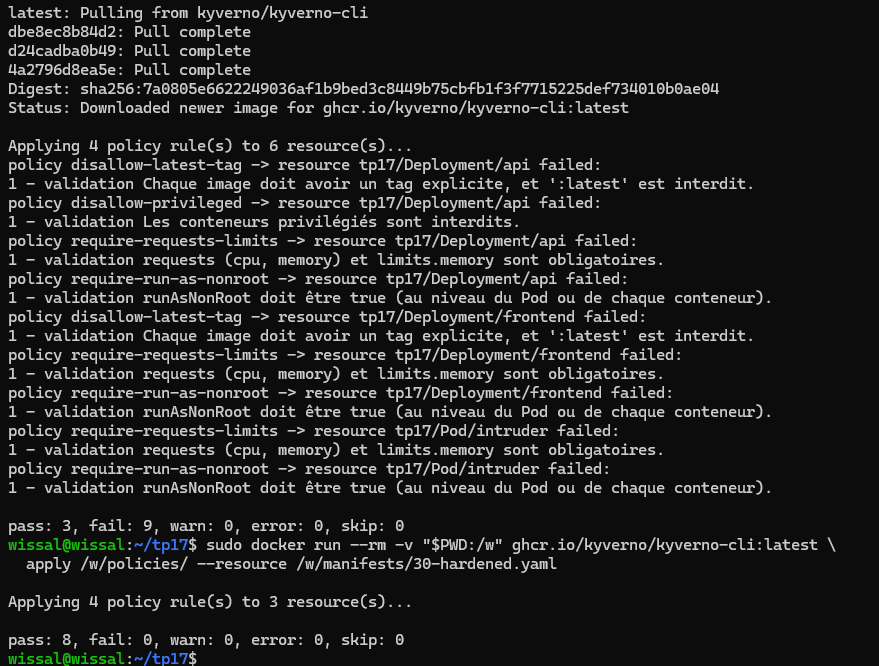

| Manifest | Résultat |
|---|---|
| `00-app.orig.yaml` (départ) | **pass: 3, fail: 9** |
| `30-hardened.yaml` (durci) | **pass: 8, fail: 0** |

### Mode Enforce

Pour les `ValidatingPolicy`, l'équivalent d'Enforce est l'action `Deny`. Les namespaces système et les outils d'infrastructure (qui ont besoin de privilèges) sont exclus par un `namespaceSelector` :

```bash
for p in $(kubectl get validatingpolicies -o name); do
  kubectl patch $p --type merge -p '{"spec":{"matchConstraints":{"namespaceSelector":{"matchExpressions":[{"key":"kubernetes.io/metadata.name","operator":"NotIn","values":["kube-system","kyverno","trivy-system","falco","gatekeeper-system","gk-test"]}]}}}}'
  kubectl patch $p --type merge -p '{"spec":{"validationActions":["Deny"]}}'
done
```

Test avec un Pod non conforme dans `default` (hors PSS, pour voir le message Kyverno) :

```bash
kubectl apply -f /tmp/bad.yaml   # nginx:latest + privileged: true
```

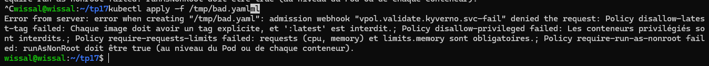

Le refus (`admission webhook "vpol.validate.kyverno.svc-fail" denied the request`) cite les quatre policies. L'installation de Trivy Operator, puis celle de Gatekeeper, ont d'ailleurs été refusées par ces policies (pas de requests/limits ni de `runAsNonRoot`) : l'Enforce fonctionne, et il faut exclure les namespaces d'outillage.

### Kyverno vs Pod Security Standards

| | Pod Security Standards | Kyverno |
|---|---|---|
| Règles | 3 profils fixes | Règles personnalisées |
| Mutation | Non | Oui (ajout automatique de champs) |
| Génération | Non | Oui (NetworkPolicy, quota à la création d'un namespace) |
| Vérification d'images | Non | Oui (signatures cosign) |
| Règles métier | Non | Oui (labels obligatoires, registres autorisés) |
| Exceptions ciblées | Limitées | Oui |
| Rapports d'audit | Via les événements | `PolicyReport` détaillés |

---

## 10. Partie 6 : Analyse continue et détection à l'exécution

### Trivy Operator

```bash
helm repo add aqua https://aquasecurity.github.io/helm-charts/ && helm repo update
helm install trivy-operator aqua/trivy-operator -n trivy-system --create-namespace --timeout 20m
```

Réglages ajoutés car le réseau de la VM est lent (les jobs de scan expiraient avant la fin du téléchargement des images) :

```bash
helm upgrade trivy-operator aqua/trivy-operator -n trivy-system --timeout 20m \
  --set operator.scanJobTimeout=30m \
  --set operator.scanJobsConcurrentLimit=1 \
  --set trivy.timeout=30m \
  --set operator.infraAssessmentScannerEnabled=false \
  --set operator.clusterComplianceEnabled=false \
  --set targetNamespaces=tp17
```

Rapports de configuration (`kubectl get configauditreports -n tp17 -o wide`) :

| Ressource | Critical | High | Medium | Low |
|---|---|---|---|---|
| `pod-intruder` | 0 | **3** | 4 | 10 |
| `replicaset-api` (durci) | 0 | 0 | 1 | 1 |
| `replicaset-frontend` (durci) | 0 | 0 | 1 | 1 |
| NetworkPolicies et Services | 0 | 0 | 0 | 0 |

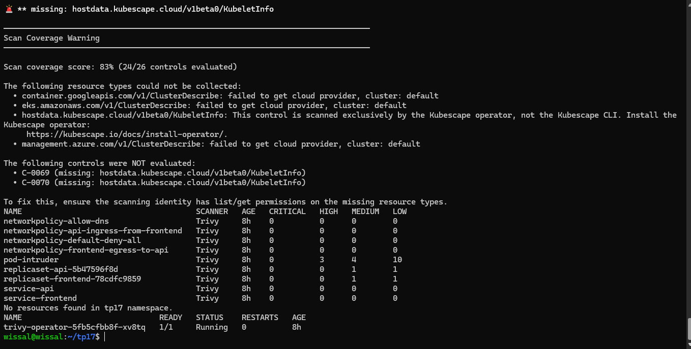

> **Limite :** les `VulnerabilityReports` n'ont pas abouti : la bande passante de la VM n'a pas permis de télécharger l'image Trivy et la base de vulnérabilités dans les délais. Les rapports de configuration (ConfigAudit) montrent néanmoins l'effet du durcissement.

### Kubescape (référentiel NSA)

```bash
kubescape scan framework nsa manifests/00-app.orig.yaml     # avant
kubescape scan framework nsa manifests/30-hardened.yaml     # après
kubescape scan framework nsa --include-namespaces tp17      # cluster
```

| Scan | Score de conformité | Contrôles échoués | Ressources en échec high |
|---|---|---|---|
| **Avant** durcissement (`00-app.orig.yaml`) | **53,33 %** | 10 / 20 | 7 |
| **Après** durcissement (`30-hardened.yaml`) | **90,00 %** | 2 / 20 | 0 |

Sortie du scan de fichier, résumé « Resource Summary » :

```text
# AVANT  (manifests/00-app.orig.yaml)
Controls: 20  Passed: 10  Failed: 10
Failed resources by severity: High 7 | Medium 16 | Low 3
Resource Summary : 4 failed / 4  ->  Compliance score 53.33%

# APRÈS  (manifests/30-hardened.yaml)
Controls: 20  Passed: 18  Failed: 2
Failed resources by severity: High 0 | Medium 4 | Low 0
Resource Summary : 2 failed / 2  ->  Compliance score 90.00%
```

Les deux contrôles qui échouent encore après durcissement sont « Non-root containers » et « Ingress and Egress blocked ». C'est un effet du scan de fichier : Kubescape cherche `runAsNonRoot` au niveau de chaque conteneur (il est défini au niveau du Pod), et les NetworkPolicies sont dans un autre fichier.

### Scan du cluster

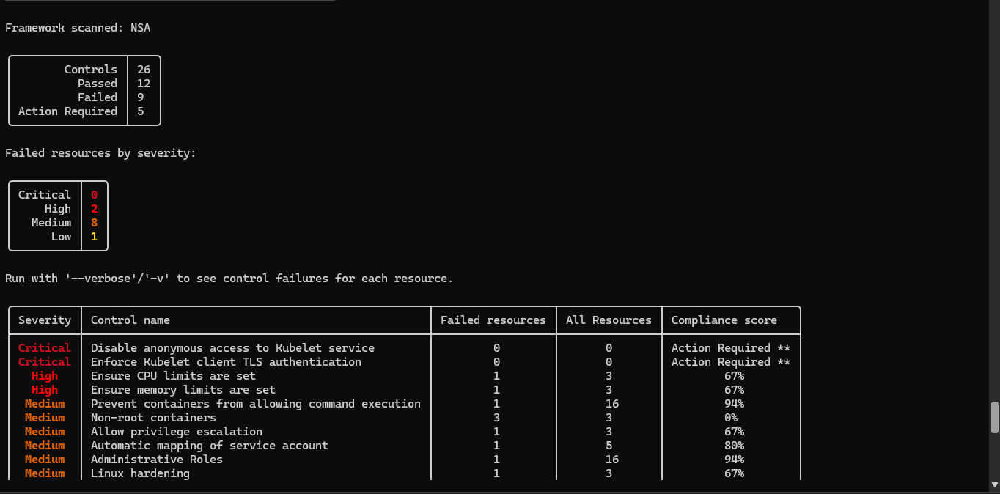

Vue d'ensemble pour le livrable (score Kubescape du cluster et rapports ConfigAudit Trivy) :

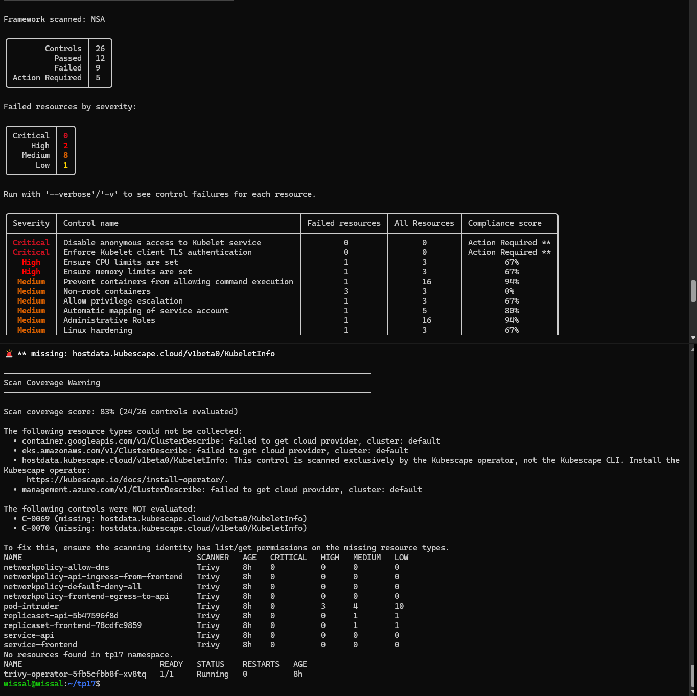

26 contrôles, 12 réussis, 9 échoués, 5 « Action Required » (contrôles Kubelet que le CLI ne peut pas évaluer sans l'opérateur Kubescape). Score de couverture : 83 % (24 contrôles évalués sur 26).

### Falco

```bash
helm repo add falcosecurity https://falcosecurity.github.io/charts && helm repo update
helm install falco falcosecurity/falco -n falco --create-namespace --timeout 20m \
  --set driver.kind=modern_ebpf --set tty=true \
  --set collectors.containerd.socket=/run/k3s/containerd/containerd.sock
```

Le socket containerd de K3s (`/run/k3s/containerd/containerd.sock`) est nécessaire pour que les alertes affichent le nom du Pod.

Événements suspects déclenchés :

```bash
kubectl -n tp17 exec -it intruder -- sh -c 'cat /etc/shadow; nc -l -p 4444 & sleep 1'
kubectl -n falco logs -l app.kubernetes.io/name=falco -c falco | grep -E 'Notice|Warning|Critical'
```

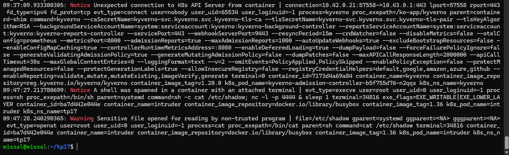

| Heure | Niveau | Alerte | Détail |
|---|---|---|---|
| 09:47:27 | Notice | A shell was spawned in a container with an attached terminal | pod `intruder`, namespace `tp17` |
| 09:47:28 | **Warning** | Sensitive file opened for reading by non-trusted program | `file=/etc/shadow`, `process=cat`, pod `intruder` |

Falco a détecté en temps réel la lecture de `/etc/shadow` et le lancement d'un shell interactif, avec le nom du Pod et du namespace.

**Faux positifs :** les nombreuses alertes `Unexpected connection to K8s API Server from container` concernent les Pods Kyverno, qui dialoguent légitimement avec l'API server. En production, on les écarterait avec une exception dans les règles Falco. Le `nc -l -p 4444` n'a pas déclenché d'alerte : la règle par défaut cible plutôt les connexions sortantes et les reverse shells.

---

## 11. Défis

### Défi 1 : mutation Kyverno du `seccompProfile`

Avec Kyverno 1.20, la mutation s'écrit en **`MutatingPolicy`** (`policies/mutate-seccomp.yaml`) : elle ajoute `seccompProfile: RuntimeDefault` aux Pods qui n'en ont pas.

Test : un Pod créé **sans** `seccompProfile` dans `default` :

```bash
kubectl get pod seccomp-test -n default -o jsonpath='{.spec.securityContext}{"\n"}'
```

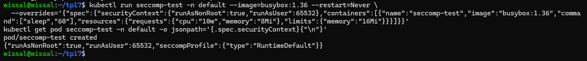

Résultat : `{"runAsNonRoot":true,"runAsUser":65532,"seccompProfile":{"type":"RuntimeDefault"}}`. Le champ a été ajouté automatiquement à l'admission. Un Pod Security Standard ne peut que refuser, alors que Kyverno peut corriger la ressource.

### Défi 2 : OPA Gatekeeper (Rego)

Installation dans `gatekeeper-system`, test dans le namespace `gk-test` (exclu des policies Kyverno pour ne pas masquer le refus de Gatekeeper). Fichier : `policies/gatekeeper-no-latest.yaml`.

```yaml
apiVersion: templates.gatekeeper.sh/v1
kind: ConstraintTemplate
metadata:
  name: k8sdisallowlatest
spec:
  crd:
    spec:
      names:
        kind: K8sDisallowLatest
  targets:
  - target: admission.k8s.gatekeeper.sh
    rego: |
      package k8sdisallowlatest
      violation[{"msg": msg}] {
        c := input.review.object.spec.containers[_]
        endswith(c.image, ":latest")
        msg := sprintf("image %v : le tag latest est interdit", [c.image])
      }
---
apiVersion: constraints.gatekeeper.sh/v1beta1
kind: K8sDisallowLatest
metadata:
  name: no-latest
spec:
  match:
    kinds:
    - apiGroups: [""]
      kinds: ["Pod"]
    namespaces: ["gk-test"]
```

```bash
kubectl run t -n gk-test --image=nginx:latest
```

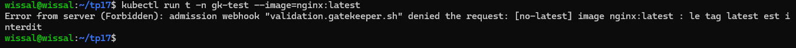

Le refus vient bien de `validation.gatekeeper.sh` : `[no-latest] image nginx:latest : le tag latest est interdit`.

**Comparaison de lisibilité :**

| | Kyverno (ValidatingPolicy) | Gatekeeper |
|---|---|---|
| Langage | YAML + CEL | Rego |
| Structure | 1 ressource par règle | `ConstraintTemplate` (logique) + `Constraint` (application) |
| Lisibilité | Expression courte, proche du manifest | Plus verbeux, langage dédié à apprendre |
| Réutilisation | Moyenne | Forte (un template, plusieurs constraints) |
| Délai d'activation | Immédiat | La CRD de la Constraint n'existe qu'après la création du template |

---

## 12. Difficultés rencontrées

| Problème | Cause | Solution |
|---|---|---|
| `ssh : Connection timed out` | Carte `VMware Network Adapter VMnet8` en état `Not Present` après un conflit avec Hyper-V | `Enable-NetAdapter -Name "VMware Network Adapter VMnet8"` (PowerShell administrateur) |
| Téléchargement de Helm : `Connection reset` | Réseau instable vers `get.helm.sh` | Réessais, puis installation alternative |
| Installation de Kyverno très lente | Pull d'images lent sur le registre | `--timeout 15m`, pré-téléchargement avec `k3s crictl pull` |
| `ClusterPolicy` refusée | Kyverno v1.20 a retiré les anciennes policies `kyverno.io/v1` | Migration vers `ValidatingPolicy` et `MutatingPolicy` (CEL) |
| Trivy Operator et Gatekeeper refusés à l'installation | Les policies Kyverno en `Deny` s'appliquent à tous les namespaces | Exclusion des namespaces d'infrastructure par `namespaceSelector` |
| Scans Trivy qui expirent en boucle | Pulls lents, délai de 5 min par défaut | `scanJobTimeout=30m`, un job à la fois, scan limité à `tp17` |
| `wget` introuvable dans le frontend | Image `nginx-unprivileged` minimale | Utilisation de `curl` |
| `no matches for kind K8sDisallowLatest` | La CRD de la Constraint n'est pas encore générée juste après le template | Attendre quelques secondes puis réappliquer |

## 13. Récapitulatif des livrables

| Livrable | Contenu | État |
|---|---|---|
| `captures/rbac-can-i.png` | `kubectl auth can-i` (yes / no) | Fait |
| `captures/pss-denied.png` | Pod privilégié refusé par `restricted` | Fait |
| `captures/netpol.png` | Frontend vers API OK, intrus bloqué | Fait |
| `captures/kyverno-enforce.png` | Pod non conforme refusé | Fait |
| `captures/kyverno-cli.png` | `kyverno apply` (3/9 puis 8/0) | Fait |
| `captures/trivy-kubescape.png` | ConfigAudit Trivy, scores Kubescape 53,33 % vers 90 % | Fait (vulnérabilités non obtenues) |
| `captures/falco-alert.png` | Alerte après lecture de `/etc/shadow` | Fait |
| `manifests/` | Manifests durcis, RBAC, NetworkPolicies | Fait |
| `policies/` | 4 `ValidatingPolicy`, 1 `MutatingPolicy`, 1 Gatekeeper | Fait |
| Défi 1 : mutation seccomp | `captures/mutation-seccomp.png` | Fait |
| Défi 2 : Gatekeeper | `captures/gatekeeper-deny.png` | Fait |

## 14. Conclusion

Le TP applique la défense en profondeur sur une application initialement permissive :

1. **RBAC** : un ServiceAccount limité à la lecture des ConfigMaps, sans jeton monté.
2. **securityContext** : conteneurs non-root, système de fichiers en lecture seule, capacités retirées.
3. **PSS** : le profil `restricted` refuse les Pods privilégiés à l'API server.
4. **NetworkPolicies** : *default deny*, puis seul le flux `frontend` vers `api` est ouvert.
5. **Kyverno** : des règles métier en Policy as Code, testables en CI avec la CLI, et une mutation automatique.
6. **Surveillance** : Trivy Operator et Kubescape mesurent le gain (53,33 % vers 90 %), Falco détecte les comportements suspects à l'exécution.
7. **Gatekeeper** : la même règle en Rego, plus puissante mais moins lisible que Kyverno.

Aucune de ces couches ne suffit seule : l'admission empêche les erreurs, le réseau limite les déplacements latéraux, et la détection à l'exécution rattrape ce qui passe à travers.
