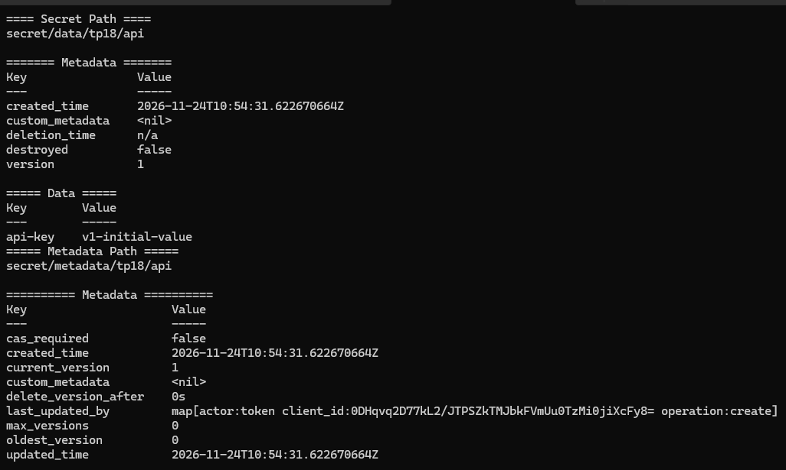
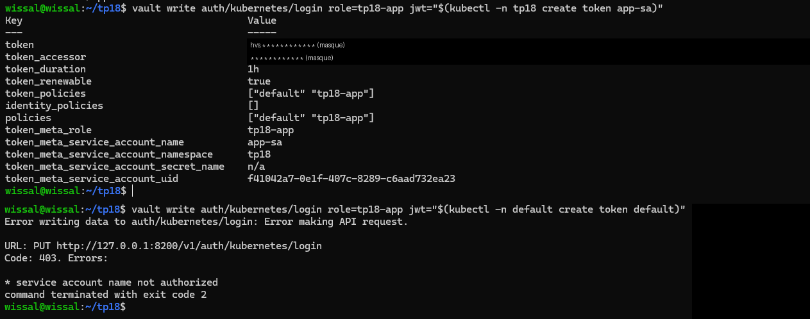
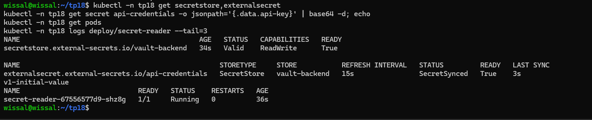
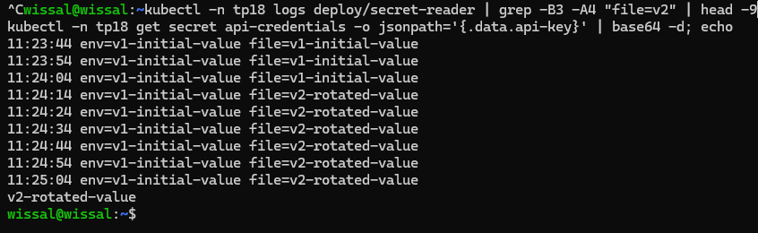
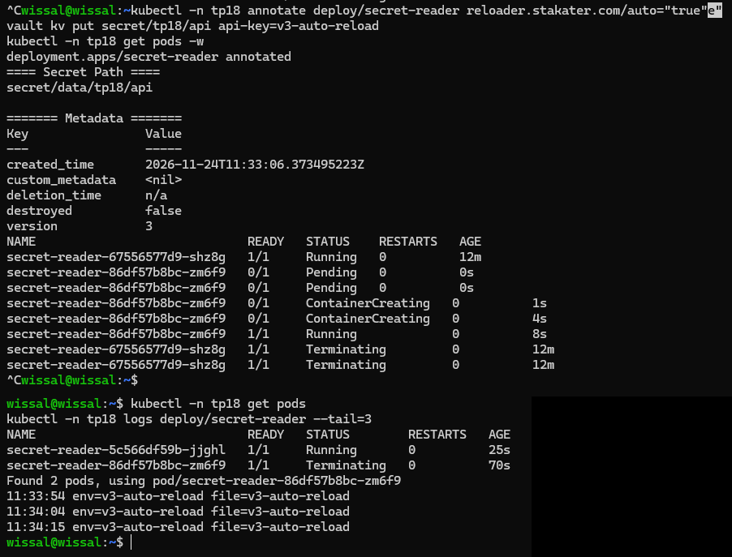
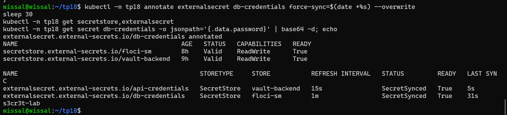
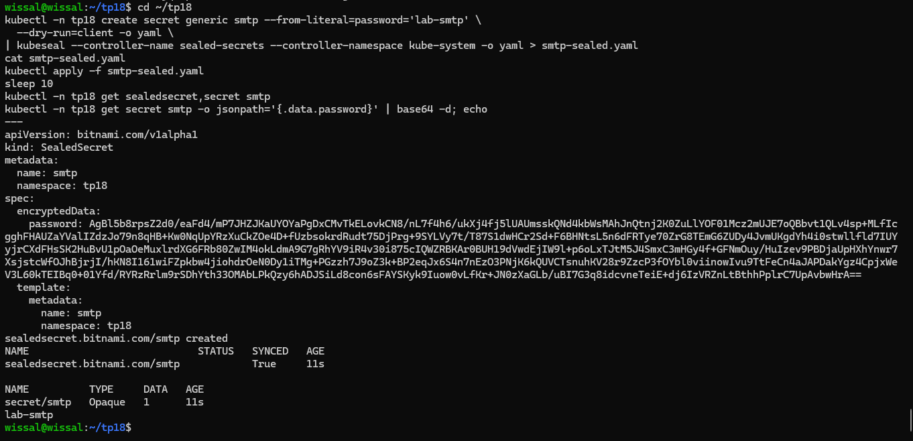
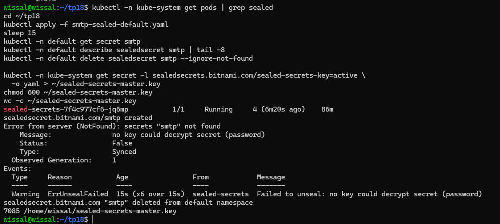
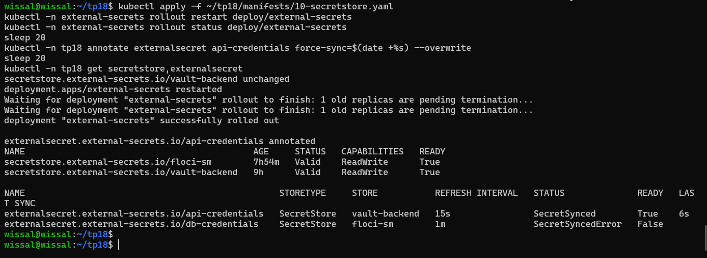

# TP18 : Gestion des secrets

HashiCorp Vault, External Secrets Operator (ESO), rotation des secrets et Sealed Secrets, sur un cluster K3s.

> **Auteur :** Wissal El Kouk  
> **Environnement :** VM Ubuntu Server (VMware, réseau NAT), K3s mono-nœud  
> **Suite du :** [TP17 : sécurité Kubernetes](../README.md)

---

## Sommaire

1. [Objectifs](#1-objectifs)
2. [Environnement et outils](#2-environnement-et-outils)
3. [Structure du dossier](#3-structure-du-dossier)
4. [Pourquoi un Secret Kubernetes ne suffit pas](#4-pourquoi-un-secret-kubernetes-ne-suffit-pas)
5. [Partie 1 : Installer Vault](#5-partie-1--installer-vault)
6. [Partie 2 : Policies et authentification Kubernetes](#6-partie-2--policies-et-authentification-kubernetes)
7. [Partie 3 : External Secrets Operator](#7-partie-3--external-secrets-operator)
8. [Partie 4 : Rotation](#8-partie-4--rotation)
9. [Partie 5 : Secrets Manager comme seconde source](#9-partie-5--secrets-manager-comme-seconde-source)
10. [Partie 6 : Sealed Secrets](#10-partie-6--sealed-secrets-gitops)
11. [Partie 7 : Synthèse comparative](#11-partie-7--synthèse-comparative)
12. [Défis](#12-défis)
13. [Difficultés rencontrées](#13-difficultés-rencontrées)
14. [Récapitulatif des livrables](#14-récapitulatif-des-livrables)
15. [Conclusion](#15-conclusion)

---

## 1. Objectifs

- Expliquer pourquoi un Secret Kubernetes ne suffit pas et comparer trois approches de gestion.
- Utiliser Vault : moteur KV v2, policies, méthode d'authentification Kubernetes.
- Synchroniser un secret de Vault (puis de Secrets Manager) vers Kubernetes avec External Secrets Operator.
- Chiffrer un secret pour Git avec Sealed Secrets.
- Réaliser une rotation et comprendre son effet sur les variables d'environnement et sur les fichiers montés.

## 2. Environnement et outils

| Composant | Version / détail |
|---|---|
| Kubernetes | K3s v1.37.2 (mono-nœud) |
| Helm | v4.3.2 |
| Vault | 2.0.4 (chart `hashicorp/vault` 0.34.1), **mode dev** |
| External Secrets Operator | chart 2.15.0 (v2.15.0), API `external-secrets.io/v1` |
| Reloader | chart `stakater/reloader` 2.2.21 |
| Sealed Secrets | chart 2.22.0 (contrôleur 0.41.2), CLI `kubeseal` 0.40.0 |
| Secrets Manager (simulé) | LocalStack 3.8 (même API AWS que Floci) |

Le CLI `vault` n'est pas installé sur la VM : il est exécuté dans le Pod `vault-0` grâce à une fonction shell.

```bash
vault() { kubectl -n vault exec -i vault-0 -- env VAULT_TOKEN=root vault "$@"; }
```

## 3. Structure du dossier

```
tp18/
├── README.md
├── smtp-sealed.yaml              # SealedSecret : valeur chiffrée, commitable
├── captures/
│   ├── vault-kv.png
│   ├── vault-k8s-auth.png
│   ├── eso-synced.png
│   ├── rotation.png
│   ├── reloader-auto.png
│   ├── eso-floci.png
│   ├── sealed-secret.png
│   ├── sealed-strict-key.png
│   └── eso-vault-restored.png
├── manifests/
│   ├── 00-app.yaml               # namespace, ServiceAccount, Pod lecteur
│   ├── 10-secretstore.yaml       # SecretStore Vault
│   ├── 20-externalsecret.yaml    # ExternalSecret Vault
│   ├── 30-secretstore-floci.yaml # SecretStore AWS Secrets Manager
│   └── 40-externalsecret-floci.yaml
└── vault/
    └── app-policy.hcl
```

> **Aucun secret en clair dans ce dépôt.** Le Secret `floci-creds` est créé en ligne de commande, la clé privée du contrôleur Sealed Secrets (`*.key`) est exclue par `.gitignore`.

## 4. Pourquoi un Secret Kubernetes ne suffit pas

Un Secret Kubernetes n'est qu'un objet encodé en **base64** : ce n'est pas du chiffrement. Quiconque peut lire les Secrets du namespace, ou accéder à etcd, voit les valeurs. On ne peut pas non plus le versionner dans Git sans exposer le secret.

Trois approches courantes :

| Approche | Principe |
|---|---|
| **Vault + ESO** | Un coffre-fort central ; ESO synchronise la valeur vers un Secret Kubernetes |
| **Sealed Secrets** | Le secret est chiffré avec la clé publique du contrôleur ; seul le contrôleur du cluster peut le déchiffrer |
| **Rotation** | Changer la valeur à la source et la propager sans redéploiement manuel |

---

## 5. Partie 1 : Installer Vault

Vault est installé en **mode dev** (stockage en mémoire, déverrouillé, jeton root `root`) : uniquement pour un lab.

```bash
helm repo add hashicorp https://helm.releases.hashicorp.com && helm repo update
helm install vault hashicorp/vault -n vault --create-namespace --timeout 20m \
  --set server.dev.enabled=true --set server.dev.devRootToken=root --set injector.enabled=false
kubectl -n vault get pods
vault status
```

`vault status` affiche `Initialized true`, `Sealed false` et `Storage Type inmem`.

> En production, Vault démarre **scellé** : il faut le déverrouiller avec plusieurs clés (Shamir) ou un auto-unseal KMS, et le stockage est persistant (Raft). Le mode dev supprime tout cela.

### Écrire et relire un secret (moteur KV v2)

```bash
vault kv put secret/tp18/api api-key=v1-initial-value
vault kv get secret/tp18/api
vault kv metadata get secret/tp18/api
```



Le moteur KV v2 conserve l'historique : la version 1 est créée, avec sa date, son auteur et `destroyed false`.

---

## 6. Partie 2 : Policies et authentification Kubernetes

### Policy en lecture seule : `vault/app-policy.hcl`

```hcl
path "secret/data/tp18/*" {
  capabilities = ["read"]
}
path "secret/metadata/tp18/*" {
  capabilities = ["read", "list"]
}
```

```bash
vault policy write tp18-app - < vault/app-policy.hcl
```

### Méthode d'authentification Kubernetes

Vault vérifie le jeton du ServiceAccount d'un Pod auprès de l'API Kubernetes.

```bash
vault auth enable kubernetes
vault write auth/kubernetes/config kubernetes_host="https://kubernetes.default.svc:443"
vault write auth/kubernetes/role/tp18-app \
  bound_service_account_names=app-sa bound_service_account_namespaces=tp18 \
  policies=tp18-app ttl=1h
```

### Test du rôle

```bash
# ServiceAccount autorisé : réussit
vault write auth/kubernetes/login role=tp18-app jwt="$(kubectl -n tp18 create token app-sa)"
# ServiceAccount d'un autre namespace : refusé
vault write auth/kubernetes/login role=tp18-app jwt="$(kubectl -n default create token default)"
```



Le jeton Vault obtenu (masqué sur la capture) porte les policies `default` et `tp18-app`, pour une durée d'**1 heure**. Le login depuis le namespace `default` est refusé : `403 service account name not authorized`.

### Quel Pod peut obtenir un jeton Vault avec ce rôle ?

Seul un Pod qui utilise le ServiceAccount **`app-sa` du namespace `tp18`** peut obtenir un jeton, et ce jeton n'a que les droits de la policy `tp18-app` (lecture sur `secret/data/tp18/*`). Un Pod d'un autre namespace, ou avec un autre ServiceAccount, est refusé : Vault compare le nom et le namespace du ServiceAccount indiqués dans le jeton aux contraintes du rôle.

---

## 7. Partie 3 : External Secrets Operator

### Installation

```bash
helm repo add external-secrets https://charts.external-secrets.io && helm repo update
helm install external-secrets external-secrets/external-secrets -n external-secrets \
  --create-namespace --timeout 20m
kubectl api-resources | grep external-secrets    # API v1
```

### Manifests

`manifests/00-app.yaml` crée le namespace `tp18`, le ServiceAccount `app-sa` et un Deployment `secret-reader` (busybox) qui affiche toutes les 10 secondes le secret lu de deux façons : **variable d'environnement** (`env=`) et **fichier monté** (`file=`). Le Pod reste en attente tant que le Secret `api-credentials` n'existe pas.

`manifests/10-secretstore.yaml` :

```yaml
apiVersion: external-secrets.io/v1
kind: SecretStore
metadata:
  name: vault-backend
  namespace: tp18
spec:
  provider:
    vault:
      server: "http://vault.vault.svc:8200"
      path: "secret"
      version: "v2"
      auth:
        kubernetes:
          mountPath: "kubernetes"
          role: "tp18-app"
          serviceAccountRef:
            name: app-sa
```

`manifests/20-externalsecret.yaml` (rafraîchissement toutes les 15 s pour accélérer le lab, la valeur par défaut est 1 h) :

```yaml
apiVersion: external-secrets.io/v1
kind: ExternalSecret
metadata:
  name: api-credentials
  namespace: tp18
spec:
  refreshInterval: 15s
  secretStoreRef:
    name: vault-backend
    kind: SecretStore
  target:
    name: api-credentials
    creationPolicy: Owner
  data:
  - secretKey: api-key
    remoteRef:
      key: tp18/api
      property: api-key
```

### Vérification

```bash
kubectl -n tp18 get secretstore,externalsecret
kubectl -n tp18 get secret api-credentials -o jsonpath='{.data.api-key}' | base64 -d
kubectl -n tp18 get pods
```



- `SecretStore vault-backend` : `Valid`, `ReadWrite`, `READY True`.
- `ExternalSecret api-credentials` : `SecretSynced`, `READY True`.
- La valeur décodée est `v1-initial-value`, et le Pod `secret-reader` est `Running`.

---

## 8. Partie 4 : Rotation

### Changer la valeur dans Vault

```bash
vault kv put secret/tp18/api api-key=v2-rotated-value
kubectl -n tp18 logs deploy/secret-reader -f
```



Extrait des logs du Pod (la valeur est changée dans Vault à 11:22:54) :

```text
11:24:04 env=v1-initial-value file=v1-initial-value
11:24:14 env=v1-initial-value file=v2-rotated-value   <- le fichier change
11:24:24 env=v1-initial-value file=v2-rotated-value   <- la variable ne change pas
```

**Constat :** le fichier monté affiche la nouvelle valeur environ 80 secondes après le changement (ESO resynchronise en 15 s, puis le kubelet met à jour le volume Secret), mais la **variable d'environnement garde l'ancienne valeur** jusqu'au redémarrage du Pod. Les variables sont fixées au démarrage du conteneur, alors que le kubelet met à jour les fichiers d'un volume Secret.

### Redémarrage automatique avec Reloader

```bash
helm repo add stakater https://stakater.github.io/stakater-charts && helm repo update
helm install reloader stakater/reloader -n reloader --create-namespace --timeout 20m
kubectl -n tp18 annotate deploy/secret-reader reloader.stakater.com/auto="true"
vault kv put secret/tp18/api api-key=v3-auto-reload
```



Après le changement de valeur (version 3), Reloader déclenche un nouveau Pod (`secret-reader-86df57b8bc-zm6f9`) et l'ancien passe en `Terminating`, sans intervention manuelle. Les logs du nouveau Pod affichent `env=v3-auto-reload file=v3-auto-reload`.

### Rollback

```bash
vault kv rollback -version=1 secret/tp18/api
vault kv metadata get secret/tp18/api
vault kv get secret/tp18/api
```

Résultat : `current_version: 4`, avec les versions 1 à 4 conservées (`destroyed false`), et `vault kv get` renvoie `v1-initial-value`.

| Version | Date (UTC) | Opération | Contenu |
|---|---|---|---|
| 1 | 10:54:31 | create | `v1-initial-value` |
| 2 | 11:22:54 | update | `v2-rotated-value` |
| 3 | 11:33:06 | update | `v3-auto-reload` |
| 4 | 11:33:42 | update (rollback) | `v1-initial-value` |

**Le rollback ne supprime aucune version** : il crée une nouvelle version dont le contenu est celui de la version 1. L'historique est donc complet et jamais réécrit.

---

## 9. Partie 5 : Secrets Manager comme seconde source

> **Adaptation :** Floci n'étant pas disponible sur la VM, **LocalStack 3.8** a été utilisé. Il expose la même API AWS Secrets Manager, donc la configuration d'ESO est identique.

```bash
docker run -d --name localstack -p 4566:4566 localstack/localstack:3.8
docker exec localstack awslocal secretsmanager create-secret \
  --name tp18/db-password --secret-string 's3cr3t-lab'
```

### Identifiants fictifs et SecretStore

```bash
kubectl -n tp18 create secret generic floci-creds \
  --from-literal=access-key=test --from-literal=secret-access-key=test
```

`manifests/30-secretstore-floci.yaml` :

```yaml
apiVersion: external-secrets.io/v1
kind: SecretStore
metadata:
  name: floci-sm
  namespace: tp18
spec:
  provider:
    aws:
      service: SecretsManager
      region: us-east-1
      auth:
        secretRef:
          accessKeyIDSecretRef:
            name: floci-creds
            key: access-key
          secretAccessKeySecretRef:
            name: floci-creds
            key: secret-access-key
```

### Pointer ESO vers l'endpoint personnalisé

```bash
helm upgrade external-secrets external-secrets/external-secrets -n external-secrets \
  --reuse-values --timeout 20m \
  --set "extraEnv[0].name=AWS_SECRETSMANAGER_ENDPOINT" \
  --set "extraEnv[0].value=http://10.0.0.25:4566"
```

### Synchronisation de `db-credentials`

`manifests/40-externalsecret-floci.yaml` synchronise `tp18/db-password` vers le Secret `db-credentials` (clé `password`).

```bash
kubectl -n tp18 get secretstore,externalsecret
kubectl -n tp18 get secret db-credentials -o jsonpath='{.data.password}' | base64 -d
```



Les deux SecretStores (`floci-sm`, `vault-backend`) sont `Valid`, les deux ExternalSecrets sont `SecretSynced`, et la valeur décodée de `db-credentials` est `s3cr3t-lab`. Avec une seule installation d'ESO, deux sources différentes alimentent des Secrets Kubernetes.

---

## 10. Partie 6 : Sealed Secrets (GitOps)

### Installation

Le dépôt Helm du projet a changé d'adresse : l'ancien `bitnami-labs.github.io` répond 404, le nouveau est `bitnami.github.io`.

```bash
helm repo add sealed-secrets https://bitnami.github.io/sealed-secrets && helm repo update
helm install sealed-secrets sealed-secrets/sealed-secrets -n kube-system --timeout 20m

KVER=0.40.0
curl -OL "https://github.com/bitnami/sealed-secrets/releases/download/v${KVER}/kubeseal-${KVER}-linux-amd64.tar.gz"
tar -xvzf kubeseal-${KVER}-linux-amd64.tar.gz kubeseal
sudo install -m 755 kubeseal /usr/local/bin/kubeseal
```

### Chiffrer un secret sans jamais l'appliquer en clair

```bash
kubectl -n tp18 create secret generic smtp --from-literal=password='lab-smtp' \
  --dry-run=client -o yaml \
| kubeseal --controller-name sealed-secrets --controller-namespace kube-system -o yaml > smtp-sealed.yaml
cat smtp-sealed.yaml
kubectl apply -f smtp-sealed.yaml
kubectl -n tp18 get sealedsecret,secret smtp
```



`smtp-sealed.yaml` contient une valeur chiffrée (`encryptedData`) : **il peut être commité dans Git**. Le contrôleur le déchiffre et crée le Secret `smtp` (`SYNCED True`), dont la valeur est `lab-smtp`.

### Portée `strict` : pourquoi le déchiffrement échoue dans un autre namespace

```bash
sed 's/namespace: tp18/namespace: default/' smtp-sealed.yaml > smtp-sealed-default.yaml
kubectl apply -f smtp-sealed-default.yaml
kubectl -n default get secret smtp
kubectl -n default describe sealedsecret smtp
```



Le SealedSecret est créé, mais le Secret reste introuvable (`secrets "smtp" not found`) et l'événement `ErrUnsealFailed` indique `no key could decrypt secret (password)`.

**Explication :** en portée `strict` (par défaut), le **nom et le namespace** du Secret font partie des données chiffrées. Changer le namespace modifie le contexte de déchiffrement, donc le contrôleur ne peut plus déchiffrer. Un SealedSecret ne peut être ni renommé ni copié vers un autre namespace.

### Que se passe-t-il si la clé privée du contrôleur est perdue ?

Les SealedSecrets existants ne peuvent plus être déchiffrés : il faut les re-chiffrer un par un avec la nouvelle clé du contrôleur, et Git ne contient plus aucune source de vérité exploitable. Il faut donc **sauvegarder la clé privée** :

```bash
kubectl -n kube-system get secret -l sealedsecrets.bitnami.com/sealed-secrets-key=active \
  -o yaml > ~/sealed-secrets-master.key
chmod 600 ~/sealed-secrets-master.key
```

La capture ci-dessus montre le fichier sauvegardé (7085 octets). Il se range dans un coffre sécurisé, **jamais dans Git**. Pour restaurer, on applique ce fichier dans `kube-system` avant (ou après) l'installation du contrôleur, puis on redémarre ce dernier. Le contrôleur génère aussi une nouvelle clé tous les 30 jours et conserve les anciennes pour déchiffrer les anciens secrets.

---

## 11. Partie 7 : Synthèse comparative

| Critère | Secret Kubernetes | Sealed Secrets | Vault + ESO |
|---|---|---|---|
| Versionnable dans Git | Non (base64 = clair) | **Oui** (valeur chiffrée) | Pas les valeurs ; oui les manifests `ExternalSecret`, qui ne contiennent aucun secret |
| Source de vérité | Le cluster (etcd) | Le dépôt Git | Vault (ou Secrets Manager) |
| Rotation | Manuelle | Manuelle : re-chiffrer, commiter, appliquer | Centralisée : changer dans Vault, ESO resynchronise |
| Audit des accès | Limité (audit de l'API Kubernetes) | Limité | Fort : journal d'audit Vault, policies fines, jetons à durée limitée |
| Complexité d'exploitation | Très faible | Faible (un contrôleur et une clé à sauvegarder) | Élevée (Vault, unseal, haute disponibilité, ESO) |
| Adapté à GitOps | Non | **Oui** | Oui (le dépôt ne contient que des références) |

---

## 12. Défis

Les deux défis optionnels n'ont **pas été réalisés** :

- Moteur `database` de Vault pour des identifiants PostgreSQL dynamiques (`ttl=1h`).
- Chiffrement des Secrets au repos dans K3s (`--secrets-encryption`, vérification avec `k3s secrets-encrypt status`).

---

## 13. Difficultés rencontrées

| Problème | Cause | Solution |
|---|---|---|
| Installation d'ESO refusée par un webhook Kyverno (`502 Bad Gateway`) | Une `MutatingPolicy` du TP17 en `failurePolicy: Fail` s'appliquait à tous les namespaces alors que Kyverno redémarrait | Suppression de la policy après capture, redémarrage de Kyverno, exclusion des namespaces d'outillage |
| `container not found ("vault")` | Le Pod `vault-0` avait été recréé pendant une saturation de la VM | Attente du téléchargement de l'image, puis reconstruction de la configuration |
| `SecretStore vault-backend` en `InvalidProviderConfig` et `api-credentials` en `SecretSyncedError` | Vault en **mode dev** stocke tout en mémoire : le redémarrage du Pod a effacé secret, policy, méthode d'authentification et rôle | Reconfiguration de Vault, redémarrage d'ESO, resynchronisation forcée |
| `db-credentials` en `SecretSyncedError` | LocalStack perd ses données quand le conteneur redémarre : le secret `tp18/db-password` n'existait plus | Recréation du secret, puis `kubectl annotate externalsecret ... force-sync=$(date +%s)` |
| `404 Not Found` à l'ajout du dépôt Helm Sealed Secrets | Le projet est passé de `bitnami-labs` à `bitnami` | Nouvelle URL `https://bitnami.github.io/sealed-secrets` |
| `TLS handshake timeout` sur l'API K3s, `connection refused` | VM à **2 CPU** saturée (load average jusqu'à 26, `PLEG is not healthy`) par Vault, Kyverno, ESO, Reloader, Sealed Secrets et LocalStack ensemble | Arrêt de LocalStack, désinstallation des outils dont les captures étaient faites, redémarrage de K3s |
| Pull d'images très lent | Réseau de la VM | `--timeout 20m`, pré-téléchargement avec `k3s crictl pull` |

Après reconstruction de Vault et redémarrage d'ESO, les deux SecretStores sont de nouveau `Valid` et `api-credentials` est `SecretSynced` :



**Leçons retenues :**

- Vault en mode dev est **volatil** : c'est l'une des raisons pour lesquelles on utilise le stockage Raft et l'auto-unseal en production.
- Un contrôleur d'admission (Kyverno) en mode `Deny` doit exclure les namespaces d'outillage, sinon il bloque l'installation de ses voisins.
- Une rafale d'outils d'infrastructure demande plus de 2 CPU : il faut dimensionner la VM en conséquence.

## 14. Récapitulatif des livrables

| Livrable | Contenu | État |
|---|---|---|
| `captures/vault-kv.png` | `vault kv get` et `vault kv metadata get` | Fait |
| `captures/vault-k8s-auth.png` | Login réussi (`app-sa`) et refusé (`default`) | Fait |
| `captures/eso-synced.png` | ExternalSecret en `SecretSynced` | Fait |
| `captures/rotation.png` | Le fichier change, la variable d'environnement non | Fait |
| `captures/eso-floci.png` | Secret synchronisé depuis Secrets Manager (LocalStack) | Fait |
| `captures/sealed-secret.png` | SealedSecret chiffré et Secret déchiffré | Fait |
| `vault/app-policy.hcl`, `manifests/`, `smtp-sealed.yaml` | Policy Vault, manifests ESO, SealedSecret | Fait |
| Tableau comparatif | Section 11 | Fait |
| Défis | Vault database, chiffrement au repos K3s | Non réalisés |

## 15. Conclusion

Trois approches ont été mises en œuvre :

1. **Vault + ESO** : la source de vérité est centralisée, ESO crée et met à jour les Secrets Kubernetes, et l'authentification Kubernetes limite l'accès à un seul ServiceAccount.
2. **Rotation** : changer la valeur dans Vault suffit à mettre à jour le fichier monté ; la variable d'environnement exige un redémarrage, que Reloader automatise.
3. **Sealed Secrets** : le secret est chiffré et versionnable dans Git, mais lié à un nom, un namespace et une clé privée à sauvegarder.

Le choix dépend du contexte : Sealed Secrets est simple et adapté à GitOps ; Vault + ESO apporte rotation, audit et sources multiples, au prix d'une exploitation plus lourde.
